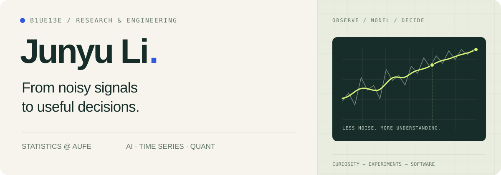
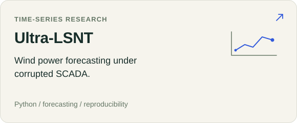
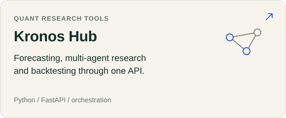
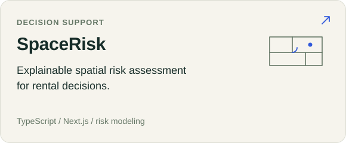
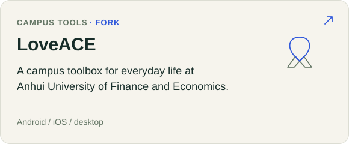

[中文介绍](README.zh-CN.md)

  

  <a href="https://b1ue13e.github.io/">Personal website ↗</a> &nbsp; / &nbsp;
  <a href="https://b1ue13e.github.io/#papers">Papers</a> &nbsp; / &nbsp;
  <a href="https://b1ue13e.github.io/#experience">Experience</a> &nbsp; / &nbsp;
  <a href="https://orcid.org/0009-0006-7574-4292">ORCID</a> &nbsp; / &nbsp;
  <a href="https://b1ue13e.github.io/assets/Junyu_Li_CV.pdf">CV (PDF)</a> &nbsp; / &nbsp;
  <a href="#selected-code">Code</a> &nbsp; / &nbsp;
  <a href="mailto:ljylikezmn999@gmail.com">Get in touch ↗</a>

## About

I'm **Junyu Li**, a statistics undergraduate at **Anhui University of Finance and Economics**. My research connects **machine learning, sequential decision-making, and optimization**.

I study how intelligent systems learn from feedback, decide when additional reasoning is worthwhile, and use learned guidance to solve constrained problems. My work also examines model reliability: how imperfect structural priors and changing representations affect learning and decisions.

## Research

- **Decision learning & optimization** — Preference learning, AHP and FlowSort, strategic multi-criteria decision support, and neural search for mixed-integer problems.
- **Reasoning & agents** — The value of additional computation, sequential semantic feedback, and agents that improve through experimentation.
- **Reliable machine learning** — Representation dynamics and grokking, prior misspecification, and robust learning in changing temporal environments.

[Papers & manuscripts](https://b1ue13e.github.io/#papers) · [Research & internship experience](https://b1ue13e.github.io/#experience) · [Current research](https://b1ue13e.github.io/#research)

## Experience

- **[Galvani Capital](https://b1ue13e.github.io/#experience-galvani)** — Internship · **2024–2025**.

## Selected code

<table>
  <tr>
    <td width="50%" valign="top">
      <a href="https://github.com/b1ue13e/Ultra-LSNT"><picture><source media="(max-width: 600px)" srcset="assets/project-ultra-mobile.svg" /></picture></a>
    </td>
    <td width="50%" valign="top">
      <a href="https://github.com/b1ue13e/kronos-hub"><picture><source media="(max-width: 600px)" srcset="assets/project-kronos-mobile.svg" /></picture></a>
    </td>
  </tr>
  <tr>
    <td width="50%" valign="top">
      <a href="https://github.com/b1ue13e/fengshui-lens"><picture><source media="(max-width: 600px)" srcset="assets/project-space-mobile.svg" /></picture></a>
    </td>
    <td width="50%" valign="top">
      <a href="https://github.com/b1ue13e/LoveACE"><picture><source media="(max-width: 600px)" srcset="assets/project-loveace-mobile.svg" /></picture></a>
    </td>
  </tr>
</table>

  
Project links &amp; descriptions

- **[Ultra-LSNT](https://github.com/b1ue13e/Ultra-LSNT)** — Wind-power forecasting under corrupted SCADA, with model code, datasets, split manifests, and evaluation workflows.
- **[Kronos Hub](https://github.com/b1ue13e/kronos-hub)** — An API hub connecting Kronos forecasting, TradingAgents research, and AI Hedge Fund execution and backtesting. [Read the docs ↗](https://b1ue13e.github.io/kronos-hub/)
- **[SpaceRisk](https://github.com/b1ue13e/fengshui-lens)** — A rental decision tool that turns housing information into explainable risks, priorities, and suggestions.
- **[LoveACE](https://github.com/b1ue13e/LoveACE)** — My fork of an AUFE campus-life toolbox with Android, iOS, and desktop clients.

## Toolkit

**Research** &nbsp; Python · PyTorch · Statistical learning · Optimization 
**Building** &nbsp; TypeScript · Next.js · FastAPI · Dart / Flutter 
**Workflow** &nbsp; Git · Linux · Reproducible experiments

---

  <a href="https://b1ue13e.github.io/">b1ue13e.github.io</a> &nbsp; · &nbsp;
  <a href="mailto:ljylikezmn999@gmail.com">ljylikezmn999@gmail.com</a> &nbsp; · &nbsp;
  <a href="https://github.com/b1ue13e?tab=repositories">All repositories ↗</a>

